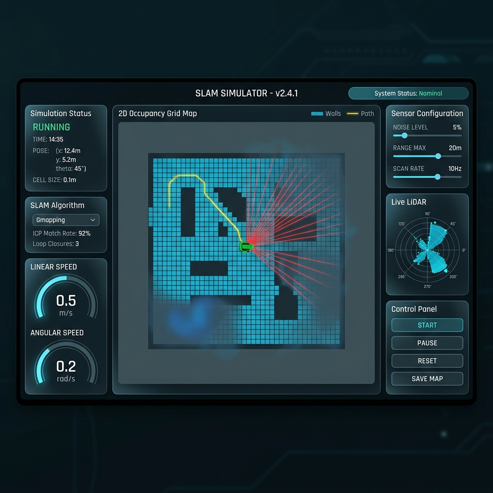
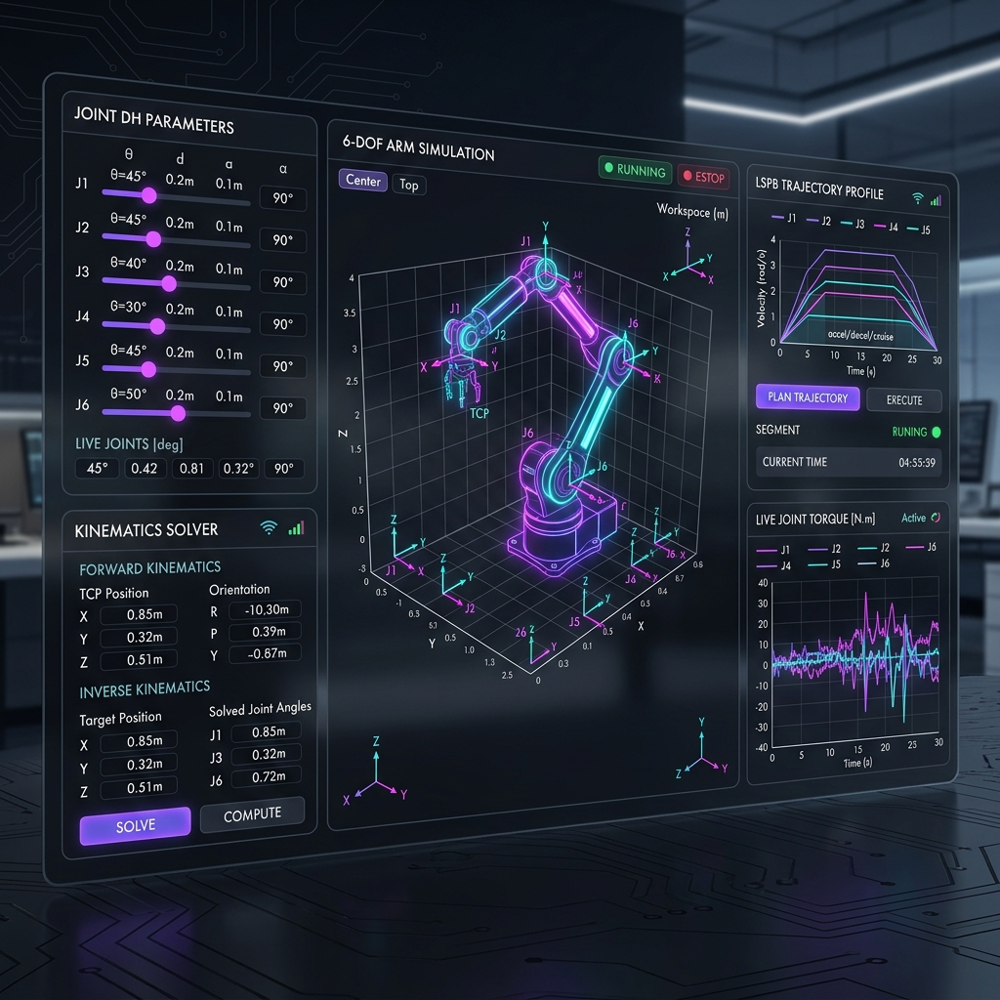
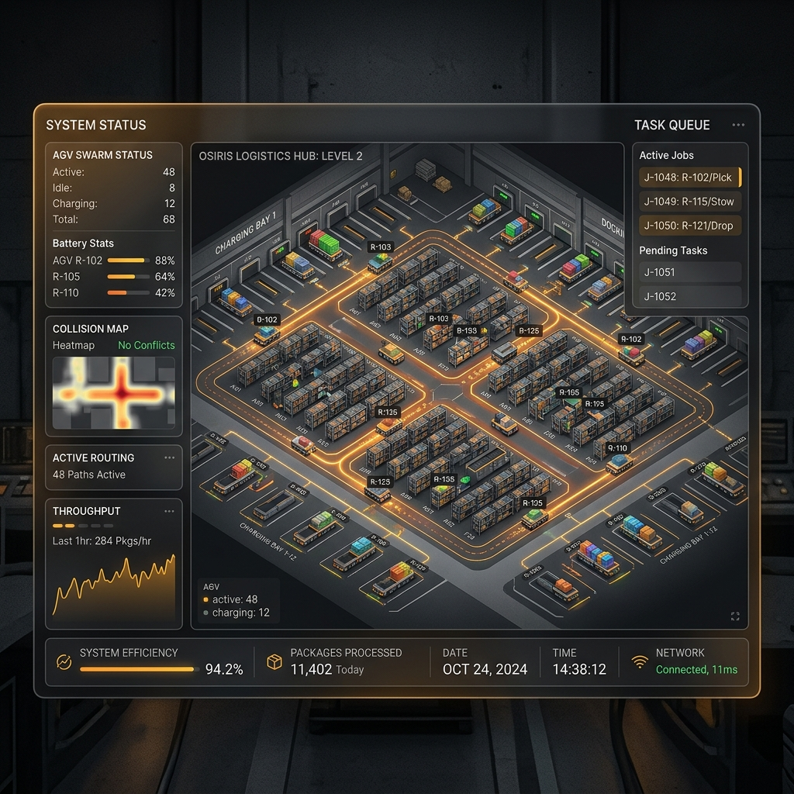
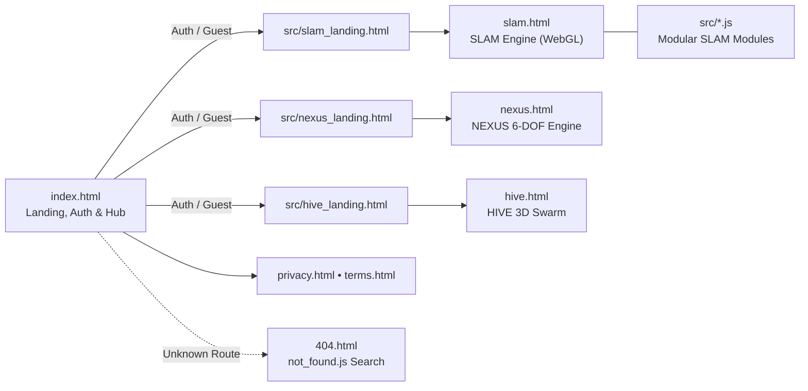

<div align="center">

<h1>VectraSim Suite</h1>

<p>
  <strong>Unified Browser-Based WebGL &amp; Canvas Robotics Simulation Platform</strong><br />
  Autonomous SLAM Mapping &bull; 6-DOF Manipulator Kinematics &amp; Dynamics &bull; Multi-AMR Swarm Logistics
</p>

<p>
  <a href="https://vectrasim.vercel.app">
    
  </a>
  
  
  
  
</p>

<p>
  <a href="#visual-showcase">Showcase</a> &bull;
  <a href="#platform-architecture">Architecture</a> &bull;
  <a href="#simulator-engines">Engines</a> &bull;
  <a href="#code-structure">Code Structure</a> &bull;
  <a href="#local-development">Quick Start</a> &bull;
  <a href="#verification--testing">QA Suite</a> &bull;
  <a href="#deployment">Vercel Deploy</a>
</p>

<br />


https://github.com/user-attachments/assets/ba1f28ce-0d1f-4e8c-9746-2a8cce212a01


<p><sub><em>VectraSim Suite unified platform landing page featuring multi-engine live previews across SLAM Perception, NEXUS 6-DOF Arm, and HIVE 3D Swarm.</em></sub></p>

</div>

---

## Overview

**VectraSim Suite** is a zero-backend, multi-page robotics education and engineering workbench built with **Vanilla ES Modules**, **HTML5 Canvas**, **Three.js**, **Chart.js**, and **GSAP**. Developed by **Yash Surve** (MESWCOE — Automation & Robotics Engineering), it brings three interactive simulation engines into one cohesive aerospace-inspired interface with optional Supabase authentication and instant Guest Demo access.

### Highlights at a Glance

- **Three Dedicated Simulation Engines:** **SLAM Engine** (autonomous mapping & localization), **NEXUS 6-DOF** (robotic manipulator kinematics, planning & dynamics), and **HIVE 3D** (multi-robot warehouse logistics & fleet scheduling).
- **Zero-Backend Ready:** Runs completely client-side in any modern browser; Supabase credentials (`VITE_SUPABASE_URL`, `VITE_SUPABASE_ANON_KEY`) unlock account sessions while automatically falling back to offline/guest mode when omitted.
- **Latest NEXUS Kinematics & Physics Upgrades (Waves 1–3):** Redundant DLS Jacobian null-space posture optimization, Quintic ($C^2$) & LSPB blended trajectories, 3D RRT path planning with greedy shortcut smoothing, Monte Carlo reachable workspace point clouds, Newton-Euler payload/inertia torque dynamics, critically damped servo tracking, top-down wrist orientation lock, and grasp stability metrics.
- **Automated Production & QA Pipeline:** Multi-page Vite build verified against `public/sitemap.xml`, native `404.html` routing tests, 20-case Playwright viewport checks (`320px`–`1440px`), and strict HTTP security headers via `vercel.json`.

---

## Visual Showcase

<div align="center">

<table>
  <tr>
    <td align="center" width="33.3%">
      <a href="https://vectrasim.vercel.app/src/slam_landing.html">
        
      </a><br />
      <strong>1. SLAM Perception</strong><br />
      <sub>360&deg; Raycasting LiDAR &bull; 2&sigma; EKF Covariance &bull; 500 MCL Particles</sub>
    </td>
    <td align="center" width="33.3%">
      <a href="https://vectrasim.vercel.app/src/nexus_landing.html">
        
      </a><br />
      <strong>2. NEXUS 6-DOF Arm</strong><br />
      <sub>6-DOF Articulated Arm &bull; &lt;1.2ms DLS IK &bull; 3&times;N Analytical Jacobian</sub>
    </td>
    <td align="center" width="33.3%">
      <a href="https://vectrasim.vercel.app/src/hive_landing.html">
        
      </a><br />
      <strong>3. HIVE 3D Swarm</strong><br />
      <sub>4 AMRs &bull; 90m&sup2; Grid &bull; 4D Space-Time A* &amp; Scissor-Lift Telemetry</sub>
    </td>
  </tr>
</table>

</div>

---

## Platform Architecture

Vite builds a **10-entry multi-page application** (`vite.config.js`): a unified entry hub (`index.html`), dedicated product landing pages (`src/*_landing.html`), standalone simulator workspaces (`slam.html`, `nexus.html`, `hive.html`), legal pages (`privacy.html`, `terms.html`), and an interactive `404.html` fallback powered by client-side search (`src/not_found.js`).



### Multi-Page Route Map

| Route / File | Role | Rendering Stack |
| :--- | :--- | :--- |
| `/` (`index.html`) | Platform landing, Supabase Auth / Guest Demo modal & Engine Hub | HTML/CSS, `src/theme.css`, `src/supabase-client.js` |
| `/src/slam_landing.html` | SLAM Engine overview, capabilities & launch gate | Shared tokens + `src/ui_enhancements.js` |
| `/src/nexus_landing.html` | NEXUS 6-DOF overview, kinematics highlights & launch gate | Shared tokens + `src/ui_enhancements.js` |
| `/src/hive_landing.html` | HIVE 3D swarm overview, scheduling highlights & launch gate | Shared tokens + `src/ui_enhancements.js` |
| `/slam.html` | **SLAM Engine** — 3D WebGL LiDAR simulator + EKF & MCL HUD | Three.js `0.184.0` (`OrbitControls`, `EffectComposer`, `UnrealBloomPass`) |
| `/nexus.html` | **NEXUS 6-DOF** — Self-contained 2–6 DOF manipulator & dynamics lab | Three.js `r128` (`OrbitControls`, `TransformControls`), Chart.js `3.9.1`, GSAP `3.12.2` |
| `/hive.html` | **HIVE 3D** — Warehouse multi-AMR simulator & benchmark dashboard | Three.js `0.184.0` (`importmap`), Chart.js `3.9.1` |
| `/privacy.html`, `/terms.html` | Legal documentation pages indexed in `public/sitemap.xml` | Shared UI enhancements & SEO meta tags |
| `/404.html` | Branded recovery page (`noindex, follow`) with live route search | `src/not_found.css`, `src/not_found.js` |

---

## Simulator Engines

### 1. SLAM Engine (`slam.html` & modular `src/*.js`)

Real-time autonomous mobile robotics simulation combining 3D WebGL post-processing visualization with classical localization, mapping, and navigation modules:

- **Localization & Uncertainty:** **EKF Sensor Fusion** with live $2\sigma$ covariance ellipse readout (`#chkEKF`, `#chkCovarianceEllipse`, `#statEKF`), togglable **Particle Filter (MCL)** (`src/ParticleFilter.js`), and keyframe scan-matching loop closure (`src/LoopClosureDetector.js`).
- **Perception & Mapping:** Configurable 2D LiDAR raycasting with Gaussian noise (`src/Lidar.js`), optional 8-channel **3D LiDAR** & **3D Voxel Map** toggles in `slam.html`, Bayesian occupancy grid (`src/Mapper.js`), and 3D point cloud rendering (`src/PointCloudViewer.js`).
- **Pathfinding & Exploration:** Interactive **A\*** (`src/AStar.js`), **Dijkstra** (`src/Dijkstra.js`), **Bug2** (`src/BugAlgorithm.js`), and **Auto-Explore (Frontier)** (`src/FrontierExplorer.js`) alongside **Dynamic Obstacles** (`src/DynamicObstacles.js`) and **Dynamic Humans** (`src/DynamicHumans.js`).
- **Vehicle Kinematics & Workspace:** Differential, Ackermann, and Holonomic robot models (`src/Robot.js`), multi-camera modes (`Top-Down`, `Follow`, `Free`) in `slam.html`, mobile virtual joystick (`src/JoystickManager.js`), and modular Canvas telemetry/comparison support (`src/main.js`). Note: `slam.html` runs the 3D WebGL engine (`Three.js 0.184.0`), while `src/*.js` holds the modular 2D Canvas SLAM architecture.

### 2. NEXUS 6-DOF (`nexus.html`)

Interactive 2–6 DOF articulated robotic manipulator sandbox designed for kinematics, motion planning, grasp physics, and dynamics analysis:

- **Dual Inverse Kinematics & Null-Space Optimization:** Switch live between **Damped Least Squares (Jacobian)** and **Singularity-Damped CCD**, with an analytical **DLS Null-Space Secondary Objective** that avoids joint limits and optionally biases wrist orientation downward while checking per-iteration safety collisions.
- **SE(3) Transform & Workspace Analysis:** Live $T_0^N$ pose matrix panel, Yoshikawa manipulability & condition-number diagnostics, and an on-demand **Monte Carlo Reachable Workspace Point Cloud** (1,400 sampled configurations color-graded by radial reach).
- **Motion Planning & Trajectory Profiling:** Choose **Quintic ($C^2$)** minimum-jerk polynomials or adjustable **LSPB** (`Blend tb` slider) profiles, or generate obstacle-avoiding 3D paths with the integrated **RRT Path Planner** (`planRRTPath` + `smoothRRTPath` with goal-biased sampling and greedy shortcutting).
- **Newton-Euler Dynamics & Realistic Grasp Physics:** Computes recursive joint torques including gravitational link weights, carried payload wrench (`box: 8.0 kg`, `gear: 4.5 kg`, `canister: 6.0 kg`), and link inertia dynamics; drives pick-and-place motion with **critically damped servo tracking** ($k_{\text{spring}} = 1600$, $k_{\text{damping}} = 80$), top-down wrist pitch lock, aligned pallet placement, and an active **grasp stability metric** ($\varepsilon$ score with $\mu = 0.65$ friction cone & force-closure indicator).

### 3. HIVE 3D (`hive.html`)

3D multi-agent warehouse automation simulator built around conflict-free coordination and fleet dispatch optimization:

- **Conflict-Free Space-Time Pathfinding:** Min-heap A\* paired with a `SpaceTimeReservations` vertex-and-edge reservation table (`isVertexReserved`, `isEdgeReserved`) to prevent swaps and head-on collisions, tracked via live `DECONFLICTS` / `DEADLOCKS` / `AVOIDS` telemetry.
- **Four Selectable Dispatch Strategies & Live Benchmark Modal:** Compare fleet performance live across **Nearest-Robot**, **Battery-Aware** (SOC quadratic penalty), **Priority-Aware** (urgent SKU weighting), and **Auction-Based (CNP)** Contract Net Protocol bidding (`dist`, SOC, load, and urgency weights).

---

## Code Structure

```text
slam-simulator/
├── index.html                  # Unified landing page, Auth/Guest modal & simulator hub
├── slam.html                   # Standalone SLAM Engine (Three.js 0.184.0 + UnrealBloom)
├── nexus.html                  # Standalone NEXUS 6-DOF simulator (Three.js r128 + Chart.js + GSAP)
├── hive.html                   # Standalone HIVE 3D swarm logistics simulator (Three.js 0.184.0 + Chart.js)
├── 404.html                    # Branded 404 fallback page with client-side search (noindex, follow)
├── privacy.html                # Privacy Policy page
├── terms.html                  # Terms & Conditions page
├── style.css                   # Shared layout stylesheet
├── vite.config.js              # Multi-page Rollup build entries (10 HTML pages)
├── vercel.json                 # Vercel static build config & 8 HTTP security headers
├── package.json                # NPM scripts (dev, build, preview, verify, test:404) & deps
├── PROJECT_CONTEXT.md          # Architectural reference & development history
│
├── public/                     # Static assets copied directly to dist/
│   ├── robots.txt              # Crawler allow rules + sitemap location
│   ├── sitemap.xml             # Canonical index of 9 public routes
│   ├── slam_simulator.png      # SLAM Perception landing & WebGL preview screenshot
│   ├── nexus_simulator.png     # NEXUS 6-DOF Arm landing & WebGL preview screenshot
│   ├── hive_simulator.png      # HIVE 3D Swarm landing & WebGL preview screenshot
│   ├── slam and lidar.png      # VectraSim Suite unified platform hero screenshot
│   └── donate.jpeg             # Project support QR code
│
├── src/
│   ├── slam_landing.html       # SLAM Engine product landing page
│   ├── nexus_landing.html      # NEXUS 6-DOF product landing page
│   ├── hive_landing.html       # HIVE 3D product landing page
│   ├── tokens.css              # Design tokens (colors, typography, radii, shadows)
│   ├── theme.css               # Shared aerospace dark-mode UI utilities
│   ├── ui_enhancements.css     # Scroll bar, cookie banner, back-to-top & FAQ styles
│   ├── ui_enhancements.js      # HTTPS redirect, cookie consent, scroll & FAQ interactions
│   ├── not_found.css           # Styles for branded 404 search experience
│   ├── not_found.js            # Client-side SITE_INDEX fuzzy matcher for 404.html
│   ├── supabase-client.js      # Optional Supabase auth client with offline fallback
│   │
│   ├── main.js                 # Modular SLAM bootstrap, game loop & planner comparison
│   ├── Renderer.js             # Multi-layer HTML5 Canvas renderer & fog-of-war
│   ├── Environment.js          # Base, custom & dynamic wall map manager
│   ├── Robot.js                # Differential, Ackermann & Holonomic kinematics
│   ├── Lidar.js                # 2D raycaster with configurable Gaussian noise
│   ├── Mapper.js               # Bayesian occupancy grid mapper
│   ├── AStar.js                # Grid A* path planner
│   ├── Dijkstra.js             # Dijkstra shortest-path planner
│   ├── BugAlgorithm.js         # Bug2 reactive boundary-following planner
│   ├── FrontierExplorer.js     # Autonomous frontier exploration selector
│   ├── ParticleFilter.js       # Monte Carlo Localization (MCL)
│   ├── LoopClosureDetector.js  # Keyframe scan-matching loop closure
│   ├── PointCloudViewer.js     # Three.js 3D LiDAR point cloud visualizer
│   ├── DynamicObstacles.js     # Moving geometric obstacles
│   ├── DynamicHumans.js        # Moving pedestrian agents
│   ├── ChartManager.js         # Chart.js polar LiDAR range plot
│   ├── DynamicsChartManager.js # Chart.js linear/angular velocity plots
│   ├── SensorVisualizer.js     # Pose, compass & sensor HUD widgets
│   ├── StatsTracker.js         # Coverage %, travel distance & collision counters
│   ├── TutorialManager.js      # Interactive step-by-step SLAM onboarding
│   ├── JoystickManager.js      # Mobile virtual thumbstick controller
│   └── SoundManager.js         # Web Audio synthesizer feedback cues
│
├── scripts/
│   ├── verify-build.js         # Audits dist/ against sitemap.xml, 404.html & vercel.json
│   └── verify-viewports.js     # Playwright check across 5 viewports x 4 landing pages (20 checks)
│
└── smoke/
    ├── 404.spec.js             # HTTP 404/200 static server contract & legal route guards
    ├── slam_ekf.spec.js        # SLAM EKF sensor fusion, 2σ ellipse & WASD drive E2E test
    ├── smoke.spec.js           # Full registration, hub & landing E2E user journey
    ├── launch.spec.js          # Initial console-error boot check
    └── *.js                    # Ad-hoc browser/DOM verification helpers
```

---

## Local Development

### Prerequisites

- **Node.js** `v18+` (with `npm`)
- Optional for Playwright tests: Chromium installed via `npx playwright install chromium`

### Setup & Run

```bash
# 1. Clone the repository
git clone https://github.com/Yashs2024/robotic-Slam-lidar-simulator.git
cd robotic-Slam-lidar-simulator

# 2. Install dependencies
npm install

# 3. Start Vite development server (default: http://localhost:5173)
npm run dev
```

### Optional Supabase Authentication (`.env`)

Authentication is **optional**. When `.env` is absent or incomplete, `src/supabase-client.js` sets `window.supabase = null` and visitors can immediately enter via **Guest / Demo Access** or simulated local sessions.

To enable live Supabase Auth, create `.env` in the repository root (already gitignored):

```env
VITE_SUPABASE_URL=https://your-project-id.supabase.co
VITE_SUPABASE_ANON_KEY=your-supabase-anon-key
```

---

## Verification & Testing

Every script below is wired in `package.json`:

| Command | Purpose |
| :--- | :--- |
| `npm run build` | Builds all 10 multi-page entries into `dist/` |
| `npm run verify:build` | Validates `dist/` coverage against `public/sitemap.xml`, `404.html`, and `vercel.json` |
| `npm run verify:viewports` | Validates overflow & primary CTA visibility across `320px`, `375px`, `768px`, `1024px`, and `1440px` on all 4 landing pages (`20` tests) |
| `npm run test:404` | Runs Playwright `smoke/404.spec.js` against `dist/` verifying HTTP `404`, HTTP `200`, `privacy.html` / `terms.html`, and 404 search markup |
| `npm run verify` | **Full release gate:** runs `build` &rarr; `verify:build` &rarr; `verify:viewports` |
| `npx playwright test` | Runs Playwright E2E specs in `smoke/` (`launch.spec.js`, `smoke.spec.js`, `slam_ekf.spec.js`, `404.spec.js`) |

> Note: `smoke.spec.js`, `launch.spec.js`, and `slam_ekf.spec.js` expect the Vite dev server running at `http://localhost:5173` (`npm run dev`).

---

## Deployment

Production builds deploy cleanly on **Vercel** using `@vercel/static-build` configured in `vercel.json`:

- **Build Command:** `npm run vercel-build` (`vite build`)
- **Output Directory:** `dist`
- **404 Routing:** Served natively by Vercel from `dist/404.html` (no `rewrites` overrides)
- **Security Headers Applied Site-Wide:**
  - `Content-Security-Policy` (restricted script, font, style, and connect sources)
  - `Strict-Transport-Security` (`HSTS`)
  - `X-Frame-Options: DENY` &bull; `X-Content-Type-Options: nosniff`
  - `Referrer-Policy` &bull; `Permissions-Policy`
  - `Cross-Origin-Opener-Policy` (`COOP`) &bull; `Cross-Origin-Resource-Policy` (`CORP`)

---

<details>
<summary><strong>Support the Project</strong> &mdash; Help keep VectraSim free and open for robotics students</summary>

<div align="center">
  <br />
  
  <p><sub>Built by <strong>Yash Surve</strong> &bull; MESWCOE Automation &amp; Robotics Engineering</sub></p>
</div>

</details>
